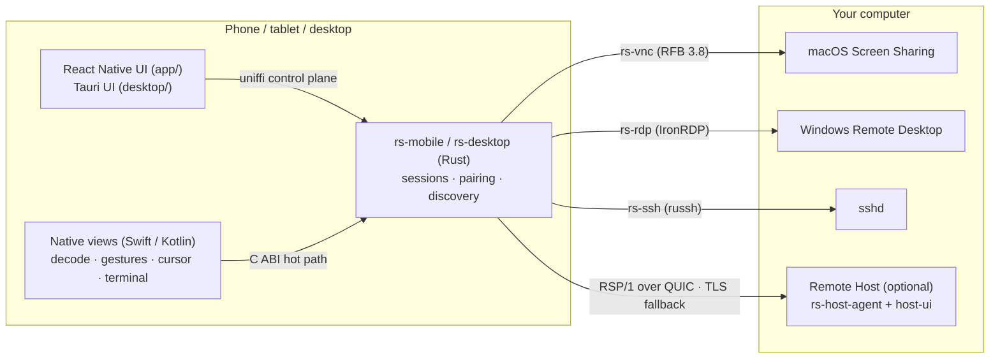

<p align="center">
  
</p>

<h1 align="center">Remote Screen</h1>

<p align="center">
  Control your own Mac, Windows and Linux computers from iPhone, iPad, Android and the desktop —<br>
  through the remote-desktop protocols they already have. No relay server, no account.
</p>

<p align="center">
  <a href="https://github.com/gxlself/remote-screen/actions/workflows/ci.yml"></a>
  <a href="#license"></a>
  
</p>

<p align="center">
  English · <a href="README.zh-CN.md">简体中文</a>
</p>

<p align="center">
  
</p>

## Why

Most remote-desktop apps want you to install an agent on every computer and route your screen through
their servers. Remote Screen goes the other way:

- **Nothing to install on the computer.** It talks to what the OS already ships: macOS **Screen Sharing**
  (VNC with Apple authentication), Windows **Remote Desktop** (RDP, via [IronRDP]), and **SSH**.
- **Your network, your path.** Connections go straight from your device to your computer — over the LAN,
  your company VPN, or your own [Tailscale]/[Headscale] tailnet. There is no server of ours in between.
- **Optional Remote Host when you want more.** Install the small Host agent and you get a purpose-built
  protocol (RSP/1 over QUIC) with hardware H.264/HEVC encoding, FEC, adaptive bitrate, sound, file
  transfer, Picture in Picture and encrypted session recording.

## Features

| | |
|---|---|
| **Touch-first control** | Trackpad and direct-touch modes, two-finger scroll, pinch to zoom, two-finger tap for right click, on-screen modifier keys |
| **Hardware input** | Hardware keyboard, mouse, trackpad and Apple Pencil; one-tap shortcuts |
| **iPad multitasking** | Portrait/landscape, Split View, Slide Over, Stage Manager; different computers in different windows |
| **Multiple displays** | Switch displays; virtual displays sized to your device (Host) |
| **SSH terminal** | Keys, jump hosts, known_hosts, tmux, SFTP; keys stay in the device keychain |
| **Files & sound** | Send files both ways, hear the remote computer (Host) |
| **Privacy & security** | Face ID / passcode lock, device keys in Secure Enclave / Android Keystore, mutual TLS with pinned device certificates, local confirmation on pairing, no analytics |
| **Discovery** | Bonjour on the LAN, address book, optional embedded tailnet node |

## Platforms

| Component | Platforms | State |
|---|---|---|
| Mobile app (`app/`) | iOS / iPadOS 16+, Android 8.0+ (API 26) | iOS 1.0 submitted to the App Store; Android builds from source |
| Desktop controller (`desktop/`) | macOS 13+, Windows 10/11 | Works, pre-release — build from source |
| Remote Host agent (`crates/rs-host-agent`) | macOS 13+, Windows 10/11, Linux (X11; Wayland via portal, view only) | Works, pre-release — build from source |
| Native protocols | macOS Screen Sharing (VNC/ARD), Windows RDP, SSH | Main connection path |

The app UI is currently Simplified Chinese only; translations are welcome.

## Architecture



Two rules shape the code: **the hot path never goes through JavaScript** (video frames, touches, pointer and
terminal bytes move between native code and Rust directly), and **every failure maps to an error code with a
next step** shown to the user.

Workspace overview:

| Path | What it is |
|---|---|
| `crates/rsp-core` | RSP/1 protocol, no I/O: wire format, control messages (protobuf), video framing + FEC, input, rate control |
| `crates/rsp-transport`, `rsp-client`, `rsp-files` | QUIC/TCP transports with mTLS, client session engine (multipath dial, recovery), file channel |
| `crates/rs-vnc`, `rs-rdp`, `rs-ssh` | Native-protocol clients: RFB 3.8 with ARD auth, IronRDP wrapper, russh/SFTP |
| `crates/rs-mobile`, `rs-desktop` | Client cores for the mobile app (uniffi + C ABI) and the desktop controller |
| `crates/host-core`, `host-mac`, `host-win`, `host-linux`, `host-fake` | Host: platform-neutral core (auth, pairing, pipeline, IPC) and per-OS capture / encode / input layers; `host-fake` is a synthetic platform for CI |
| `crates/rs-host-agent` | The Host daemon binary |
| `crates/rs-audio`, `rs-recording`, `rs-tailnet` | Opus audio, encrypted recording, embedded tailnet bindings |
| `proto/rsp/v1` | Protobuf contracts (generated in pure Rust with prost + protox — no `protoc` needed) |
| `app/` | React Native app (iOS + Android) with native Swift/Kotlin session views |
| `host-ui/`, `desktop/` | Tauri 2 apps: Host menu-bar/tray UI, desktop controller shell |
| `tailnet/` | Go module embedding a [tsnet] node, exposed through a C ABI |
| `drivers/win-iddcx` | Windows virtual-display driver (IddCx, UMDF 2) |
| `fuzz/`, `tools/` | cargo-fuzz targets, CI scripts, latency/netem/bench tooling, release scripts |

Design documents (in Chinese) live in [`docs/dev/`](docs/dev/README.md): decisions, protocol spec,
identity & security, Host, app, quality & release.

## Building from source

The single entry point is the [`justfile`](justfile). You need [`just`](https://github.com/casey/just),
Rust via `rustup` (the toolchain in `rust-toolchain.toml` installs itself), and — depending on what you build —
Node 22 + pnpm 11, Go 1.26, JDK 17 + Android SDK/NDK 27, or Xcode 26 + CocoaPods.
See [docs/dev/02-repo-env.md](docs/dev/02-repo-env.md) for the full list.

```bash
cargo install --locked cargo-nextest cargo-deny
```

Run the checks (Linux or macOS):

```bash
bash tools/ci/check-linux.sh
```

`--only fmt,clippy,tests` picks sections; `--list` shows them all.

Try the protocol end to end without any real screen — a synthetic Host and a probe client on loopback:

```bash
just host-fake --bind 127.0.0.1:7400 --dev-allow-unpaired
```

```bash
just probe --addr 127.0.0.1:7400 --dev-allow-unpaired --seconds 5
```

Other recipes:

| Command | Builds / runs |
|---|---|
| `just host` | Host agent on this Mac (grant Screen Recording and Accessibility to your terminal) |
| `just ios` / `just android` | Rust core for the platform, then the React Native app |
| `just host-ui` | Host menu-bar / tray UI (Tauri) |
| `just desktop` | Desktop controller (Tauri) |
| `just fuzz <target>` | A cargo-fuzz target (nightly) |
| `just e2e-fake` | Full-stack integration tests on Linux (needs `CAP_NET_ADMIN`) |

Release scripts (`just release-*`) need your own signing identities; see
[docs/dev/09-quality-release.md](docs/dev/09-quality-release.md).

## Security

Remote Screen controls computers — please report vulnerabilities privately, as described in
[SECURITY.md](SECURITY.md). Only connect to computers you own or are allowed to manage.

## Contributing

Issues and pull requests are welcome. Start with [CONTRIBUTING.md](CONTRIBUTING.md); everyone taking part
follows the [Code of Conduct](CODE_OF_CONDUCT.md).

## License

Licensed under either of

- Apache License, Version 2.0 ([LICENSE-APACHE](LICENSE-APACHE))
- MIT license ([LICENSE-MIT](LICENSE-MIT))

at your option. Third-party code bundled in this repository keeps its own license; see
[THIRD_PARTY_NOTICES.md](THIRD_PARTY_NOTICES.md).

Unless you explicitly state otherwise, any contribution intentionally submitted for inclusion in the work by
you, as defined in the Apache-2.0 license, shall be dual licensed as above, without any additional terms or
conditions.

[IronRDP]: https://github.com/Devolutions/IronRDP
[Tailscale]: https://tailscale.com
[Headscale]: https://github.com/juanfont/headscale
[tsnet]: https://pkg.go.dev/tailscale.com/tsnet
