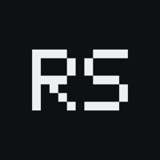
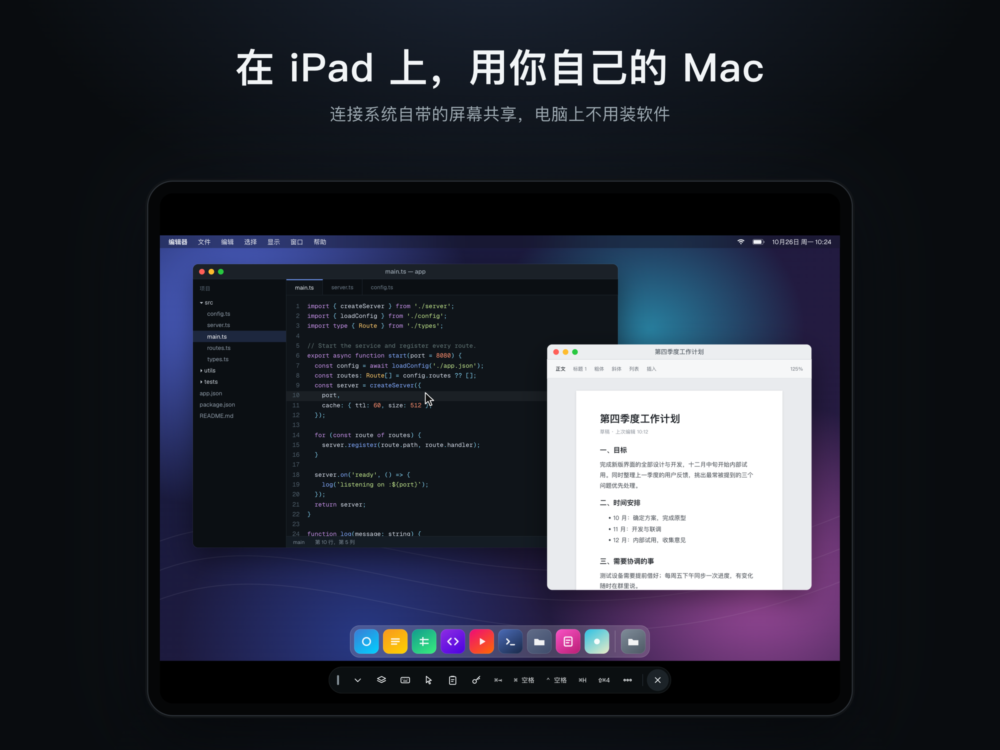
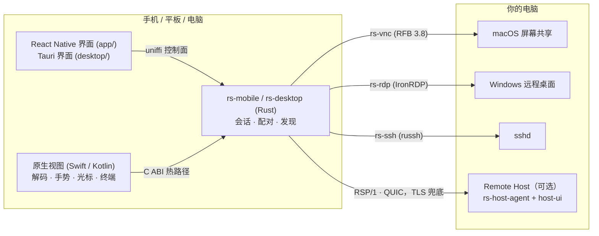

<p align="center">
  
</p>

<h1 align="center">远屏 Remote Screen</h1>

<p align="center">
  用 iPhone、iPad、Android 和电脑远控你自己的 Mac、Windows、Linux——<br>
  直接用系统自带的远程桌面协议。没有中转服务器，不用注册账号。
</p>

<p align="center">
  <a href="https://github.com/gxlself/remote-screen/actions/workflows/ci.yml"></a>
  <a href="#许可证"></a>
  
</p>

<p align="center">
  <a href="README.md">English</a> · 简体中文
</p>

<p align="center">
  
</p>

## 为什么做这个

多数远程桌面软件要求每台电脑都装客户端，画面还要经过它们的服务器。远屏反过来：

- **电脑上不用装软件。** 直接连系统自带的功能：macOS **屏幕共享**（VNC + Apple 认证）、Windows
  **远程桌面**（RDP，基于 [IronRDP]）和 **SSH**。
- **走你自己的网络。** 设备和电脑之间直连：同一局域网、公司 VPN，或者你自建的
  [Tailscale]/[Headscale] tailnet。中间没有我们的服务器。
- **想要更好的体验，再装 Remote Host。** 装上可选的被控端后，走专门设计的 RSP/1 协议（QUIC），
  硬件 H.264/HEVC 编码、FEC、自适应码率，还有声音、文件互传、画中画和加密录屏。

## 功能

| | |
|---|---|
| **为触控设计** | 触控板模式和直接点按模式、双指滚动、捏合缩放、双指轻点右键、屏幕修饰键 |
| **外接输入** | 硬件键盘、鼠标、触控板、Apple Pencil；一键快捷键 |
| **iPad 多任务** | 横竖屏、分屏浏览、侧拉、台前调度；不同窗口连不同电脑 |
| **多显示器** | 切换显示器；按设备尺寸创建虚拟显示器（Host） |
| **SSH 终端** | 密钥、跳板机、known_hosts、tmux、SFTP；私钥只存在设备钥匙串 |
| **文件和声音** | 双向传文件、听电脑的声音（Host） |
| **隐私和安全** | Face ID / 密码锁、设备私钥存于安全隔区 / Android Keystore、双向 TLS + 设备证书固定、配对需在电脑上确认、没有统计 SDK |
| **发现设备** | 局域网 Bonjour、地址簿、可选的内嵌 tailnet 节点 |

## 平台

| 组件 | 平台 | 状态 |
|---|---|---|
| 手机 App（`app/`） | iOS / iPadOS 16+、Android 8.0+（API 26） | iOS 1.0 已提交 App Store 审核；Android 需自行构建 |
| 电脑端控制端（`desktop/`） | macOS 13+、Windows 10/11 | 可用，未正式发布，需自行构建 |
| Remote Host 被控端（`crates/rs-host-agent`） | macOS 13+、Windows 10/11、Linux（X11；Wayland 经 portal 只看不控） | 可用，未正式发布，需自行构建 |
| 系统原生协议 | macOS 屏幕共享（VNC/ARD）、Windows RDP、SSH | 主连接方式 |

App 界面目前只有简体中文，欢迎贡献翻译。

## 架构



两条贯穿全部代码的规则：**热路径不经过 JS**（视频帧、触摸、指针、终端字节在原生层和 Rust 之间直接走）；
**每个失败都有错误码和下一步**，用户看到的是能照着做的提示。

目录：

| 路径 | 内容 |
|---|---|
| `crates/rsp-core` | RSP/1 协议本体，无 I/O：线格式、控制消息（protobuf）、视频分片 + FEC、输入、码率控制 |
| `crates/rsp-transport`、`rsp-client`、`rsp-files` | QUIC/TCP 传输与 mTLS、客户端会话引擎（多路径拨号、恢复）、文件通道 |
| `crates/rs-vnc`、`rs-rdp`、`rs-ssh` | 原生协议客户端：RFB 3.8 + ARD 认证、IronRDP 封装、russh/SFTP |
| `crates/rs-mobile`、`rs-desktop` | 手机 App（uniffi + C ABI）和电脑端控制端的 Rust 核心 |
| `crates/host-core`、`host-mac`、`host-win`、`host-linux`、`host-fake` | 被控端：平台无关核心（鉴权、配对、管线、IPC）和各系统的采集 / 编码 / 注入；`host-fake` 是 CI 用的合成平台 |
| `crates/rs-host-agent` | 被控端常驻进程 |
| `crates/rs-audio`、`rs-recording`、`rs-tailnet` | Opus 声音、加密录屏、内嵌 tailnet 绑定 |
| `proto/rsp/v1` | protobuf 契约（prost + protox 纯 Rust 生成，不需要 `protoc`） |
| `app/` | React Native App（iOS + Android），会话视图是原生 Swift/Kotlin |
| `host-ui/`、`desktop/` | Tauri 2 应用：被控端菜单栏/托盘界面、电脑端控制端外壳 |
| `tailnet/` | 内嵌 [tsnet] 节点的 Go module，经 C ABI 导出 |
| `drivers/win-iddcx` | Windows 虚拟显示器驱动（IddCx，UMDF 2） |
| `fuzz/`、`tools/` | cargo-fuzz 目标、CI 脚本、延迟/弱网/对照基准工具、发版脚本 |

设计文档在 [`docs/dev/`](docs/dev/README.md)：技术决策、协议规范、身份与安全、被控端、App、质量与发布。

## 从源码构建

统一入口是 [`justfile`](justfile)。需要 [`just`](https://github.com/casey/just)、用 `rustup` 装的 Rust
（`rust-toolchain.toml` 会自动装对应版本），按要构建的部分再装 Node 22 + pnpm 11、Go 1.26、
JDK 17 + Android SDK/NDK 27，或 Xcode 26 + CocoaPods。完整清单见
[docs/dev/02-repo-env.md](docs/dev/02-repo-env.md)。

```bash
cargo install --locked cargo-nextest cargo-deny
```

跑检查（Linux 或 macOS）：

```bash
bash tools/ci/check-linux.sh
```

`--only fmt,clippy,tests` 选部分，`--list` 列出全部。

不需要真实屏幕也能把协议跑通——本机起一个合成画面的被控端，再用探测客户端连上：

```bash
just host-fake --bind 127.0.0.1:7400 --dev-allow-unpaired
```

```bash
just probe --addr 127.0.0.1:7400 --dev-allow-unpaired --seconds 5
```

其他命令：

| 命令 | 内容 |
|---|---|
| `just host` | 在这台 Mac 上跑被控端（把「屏幕录制」和「辅助功能」授权给终端） |
| `just ios` / `just android` | 先编对应平台的 Rust 核心，再跑 React Native App |
| `just host-ui` | 被控端菜单栏 / 托盘界面（Tauri） |
| `just desktop` | 电脑端控制端（Tauri） |
| `just fuzz <target>` | 跑一个模糊测试目标（nightly） |
| `just e2e-fake` | Linux 上的全链路集成测试（需要 `CAP_NET_ADMIN`） |

发版脚本（`just release-*`）需要你自己的签名身份，见
[docs/dev/09-quality-release.md](docs/dev/09-quality-release.md)。

## 安全

远屏是用来控制电脑的。发现漏洞请按 [SECURITY.md](SECURITY.md) 私下报告。只连接你自己的、或有权管理的电脑。

## 参与贡献

欢迎提 issue 和 PR，先看 [CONTRIBUTING.md](CONTRIBUTING.md)。参与者请遵守[行为准则](CODE_OF_CONDUCT.md)。

## 许可证

可任选以下之一：

- Apache License 2.0（[LICENSE-APACHE](LICENSE-APACHE)）
- MIT 许可证（[LICENSE-MIT](LICENSE-MIT)）

仓库里附带的第三方代码保留各自的许可证，见 [THIRD_PARTY_NOTICES.md](THIRD_PARTY_NOTICES.md)。

除非你明确声明，否则你有意提交并纳入本项目的贡献（按 Apache-2.0 的定义），都按上述双许可证授权，不附加其他条款。

[IronRDP]: https://github.com/Devolutions/IronRDP
[Tailscale]: https://tailscale.com
[Headscale]: https://github.com/juanfont/headscale
[tsnet]: https://pkg.go.dev/tailscale.com/tsnet
